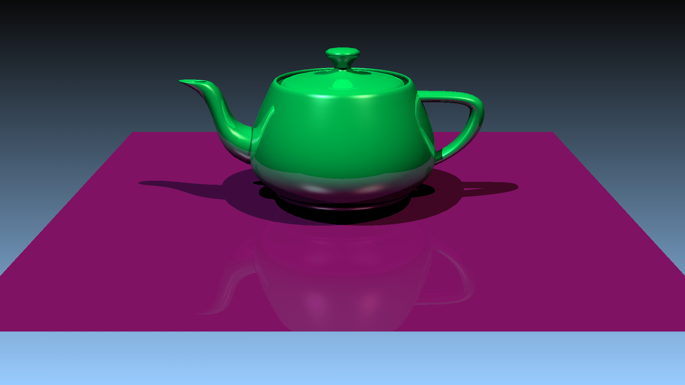
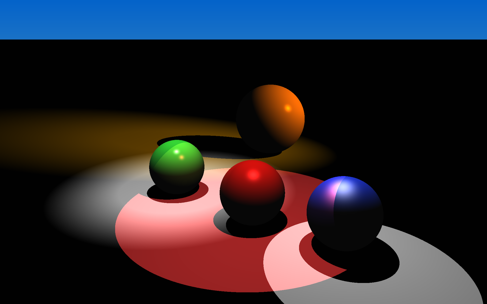
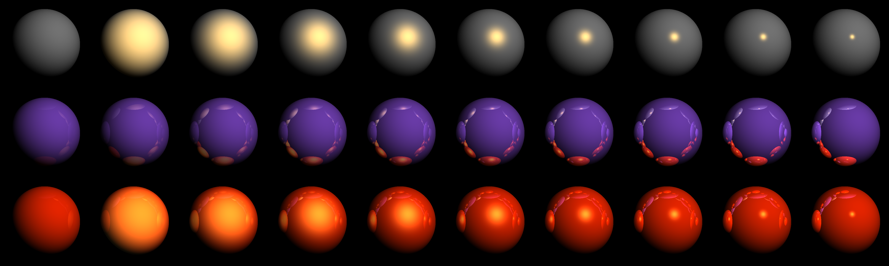

= Raytracer
Vinicius Sampaio <vldsampaio@pm.me>
:toc: left

Lightweight raytracer written in zig. WIP.

.link:doc/examples/teapot/teapot.zon.[Teapot]

== Build

Make sure you have zig 0.16.0 installed before building. Use:

[source,bash]
----
zig build -Doptimize=ReleaseSafe
----

The generated output will be on `zig-out/bin`. You can also run with:

[source,bash]
----
zig build run -Doptimize=ReleaseSafe -- <args...>
----

Tests are run with:

[source,bash]
----
zig build tests
----

Lints are run with:

[source,bash]
----
zig build lint
----

For more options you can check `zig build -h` in the section `steps`.

=== Just

The justfile serves convenient aliases for the the options offered by the zig
build system. You can see the available options with:

[source,bash]
----
just -l
----

=== Nix

The project contains a flake that bootstraps a devShell a package and
some checks for the project, these are:

[source,bash]
----
# Builds the project to the directory `result` in ReleaseSafe mode.
nix build

# Runs the project with some args.
nix run . -- <args..>

# Executes tests and linting.
nix flake check
----

== Examples

nthere

.link:doc/examples/spotlights/spotlights.zon[Spotlights]

.link:doc/examples/rows_mirror_spheres/row_of_spheres_gc.zon[Row of Spheres]

