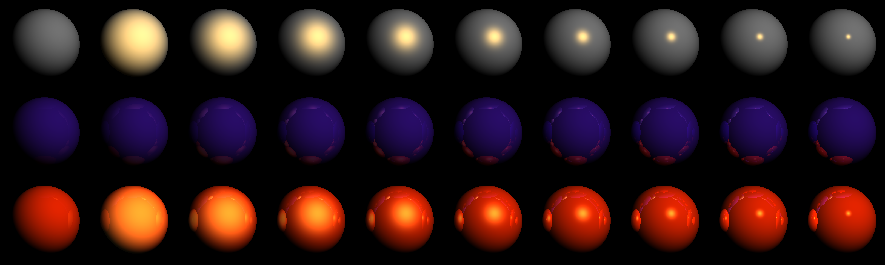

# Raytracer project - Computer Graphics

Lightweight raytracer written in zig. WIP.


> Scene file [./scenes/teapot/teapot.zon](./scenes/teapot/teapot.zon).

## Build

Make sure you have zig 0.16.0 installed before building. Use:

```bash
zig build -Doptimize=ReleaseSafe
```

The generated output will be on `zig-out/bin`. You can also run with:

```bash
zig build run -Doptimize=ReleaseSafe -- <args...>
```

Tests are run with:

```bash
zig build tests
```

For more options you can check `zig build -h` in the section `steps`.

## Just

You can use the justfile in the root directory of the project, see:

```bash
just -l
```

## Nix

The project contains a flake that bootstraps a devShell a package and some
checks for the project, these are:

```bash
# Builds the project to the directory `result` in ReleaseSafe mode.
nix build

# Runs the project with some args.
nix run . -- <args..>

# Executes tests and linting.
nix flake check
```

## Examples


> Scene file
> [./scenes/spotlights/spotlights.zon](./scenes/spotlights/spotlights.zon)



> Scene file
> [./scenes/rows_mirror_spheres/row_of_spheres_gc.zon](./scenes/rows_mirror_spheres/row_of_spheres_gc.zon)
